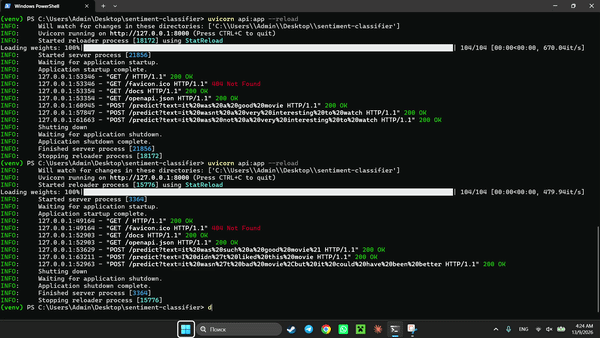

# Sentiment Classifier: Fine-tuned DistilBERT

[](https://github.com/AlibekBerik/sentiment-classifier/actions/workflows/tests.yml)
[](https://huggingface.co/spaces/Zolotouly/movie-review-sentiment)
[](https://huggingface.co/Zolotouly/sentiment-classifier-model)


A sentiment analysis model fine-tuned on the IMDb dataset and served through a FastAPI backend.

**Try it in your browser:** https://huggingface.co/spaces/Zolotouly/movie-review-sentiment



The API classifies text as positive or negative in real time.

## Results

| Epoch | Accuracy | F1 Score |
|---|---|---|
| **1 (final model)** | **85.9%** | **0.866** |
| 2 | 87.3% | 0.873 |

Training used `load_best_model_at_end=True`, which keeps the checkpoint with the lowest validation loss. That was epoch 1, so it is the published model, even though epoch 2 scored slightly higher on accuracy and F1.

## Training details

- Base model: `distilbert-base-uncased`
- Dataset: IMDb (`stanfordnlp/imdb`), 3,000 training reviews / 1,000 test reviews
- Epochs: 2
- Batch size: 16
- Max sequence length: 256
- Training environment: Google Colab (T4 GPU)

## Model

The trained model is on the Hugging Face Hub: [Zolotouly/sentiment-classifier-model](https://huggingface.co/Zolotouly/sentiment-classifier-model). The API downloads it from there automatically.

## Running it yourself

```bash
git clone https://github.com/AlibekBerik/sentiment-classifier
cd sentiment-classifier
pip install -r requirements.txt
uvicorn api:app --reload
```

Then open `http://127.0.0.1:8000/docs` and try the `/predict` endpoint.

The model is chosen in this order: the `MODEL_ID` environment variable, then a local `./sentiment_model` folder (created by `src/train.py`), then the Hub model above.

## Tests

API tests run in CI on every push, with a stand-in classifier so no model download is needed. They cover label mapping, confidence rounding, input validation and model selection.

```bash
pip install -r requirements-dev.txt
pytest
```

## Browser demo

The live demo runs from `space/`: a Gradio app on Hugging Face Spaces (ZeroGPU), so anyone can try the model without installing anything.

## Tech stack

PyTorch · Hugging Face Transformers · FastAPI · Hugging Face Hub · Gradio · pytest · GitHub Actions
